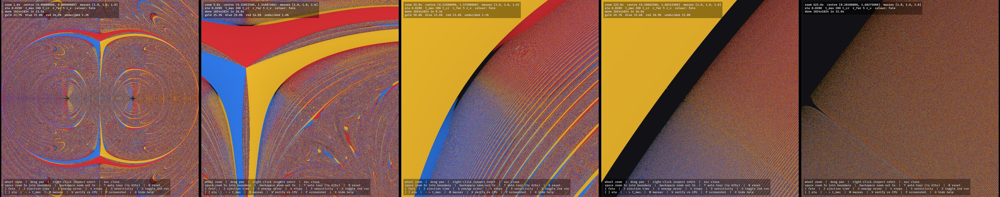
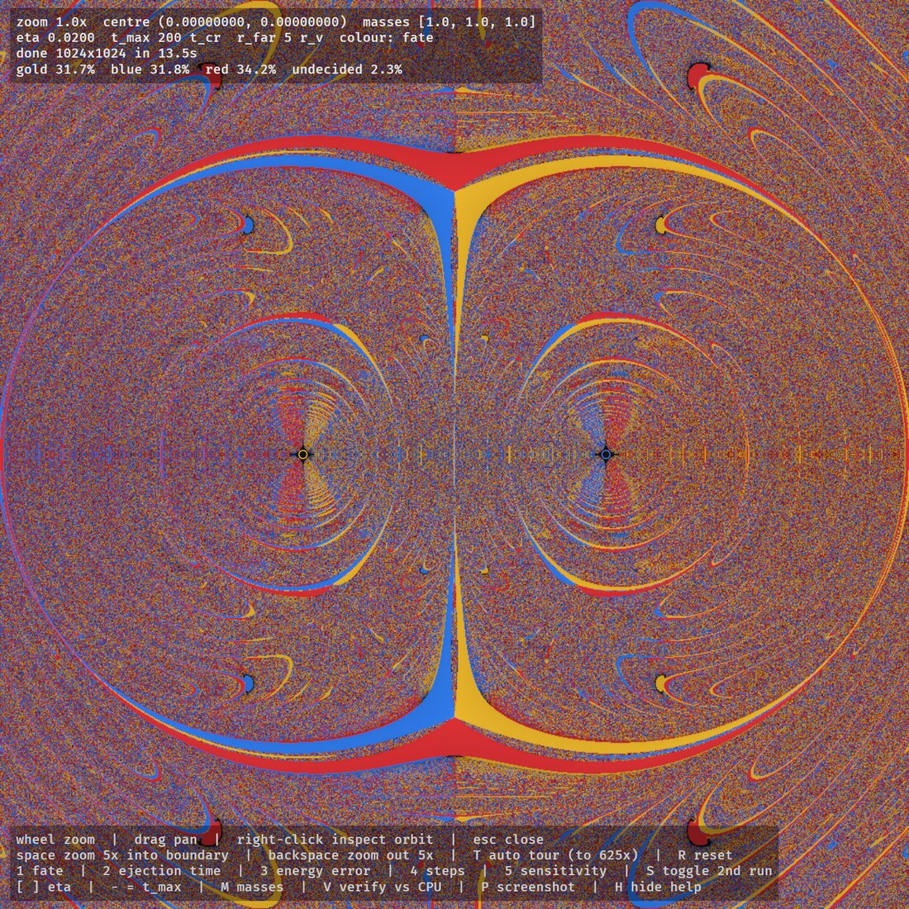
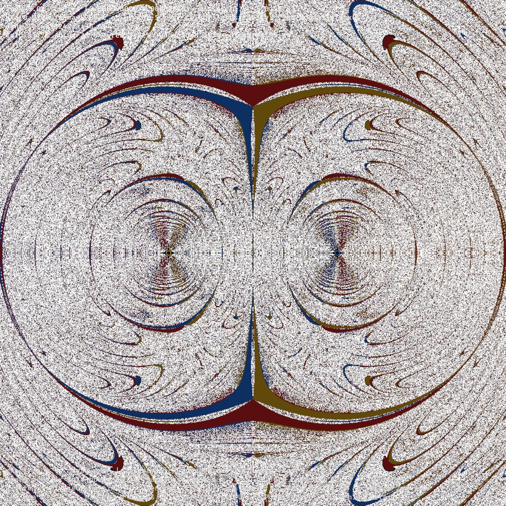
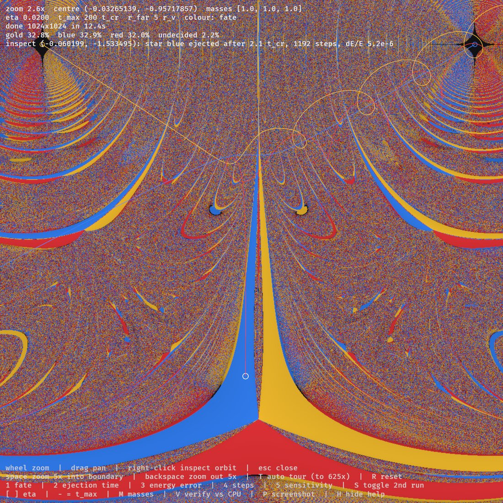
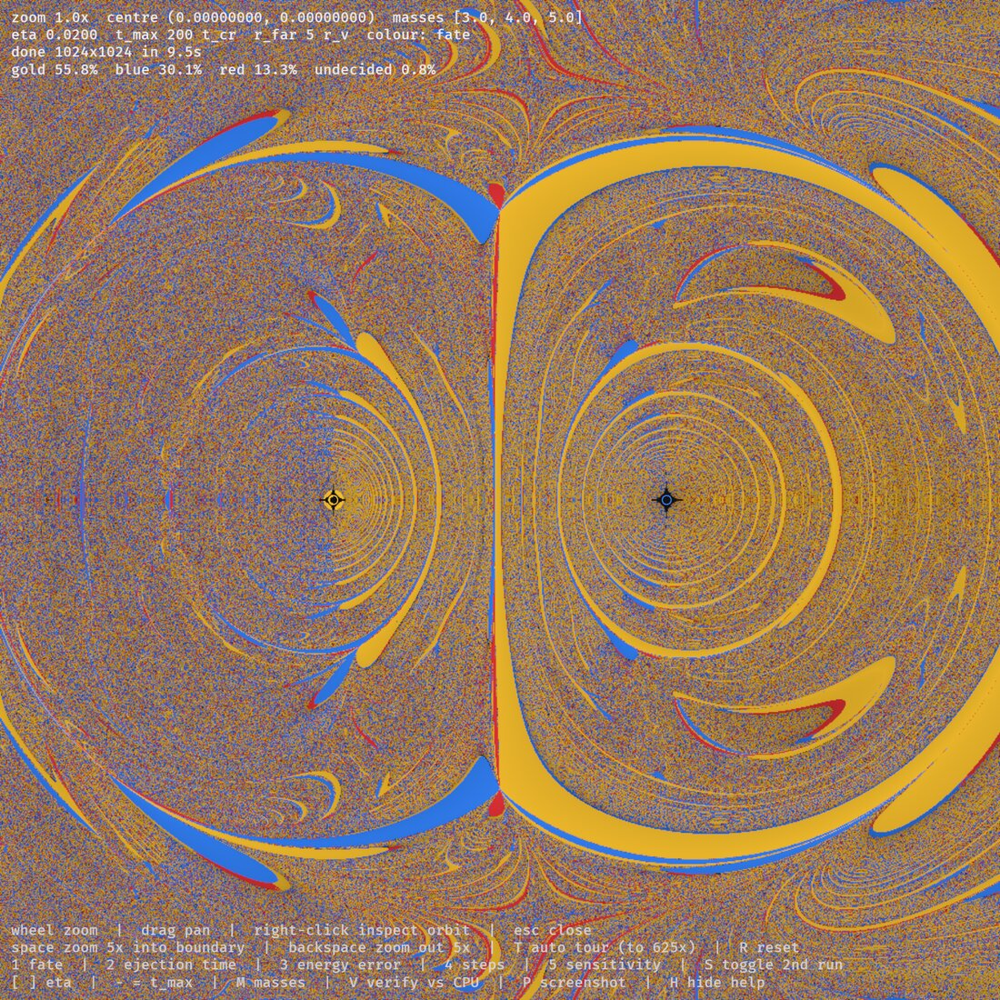
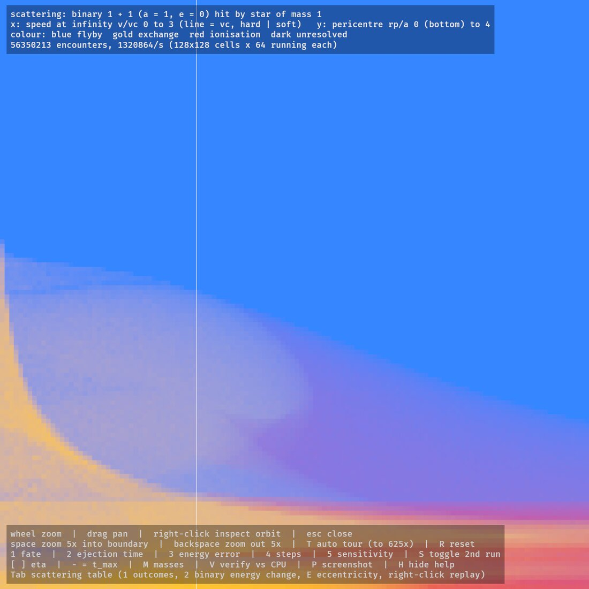
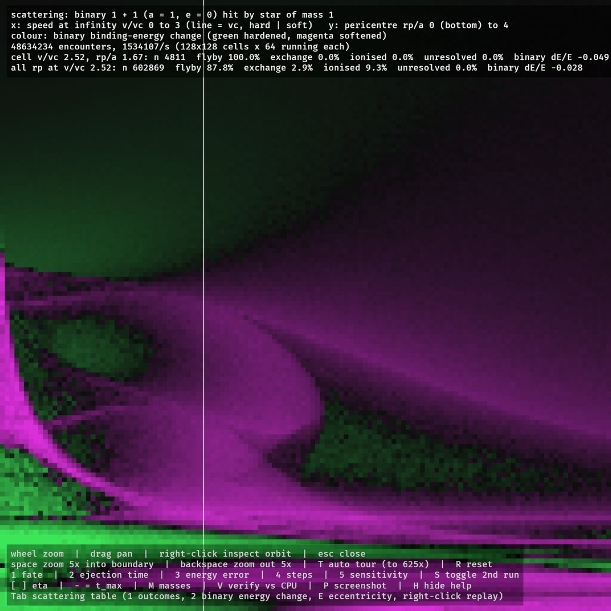

# Three-body ejection fractal (Bevy 0.20 + WGSL compute)

Every pixel is its own three-body problem. Three equal stars start at rest: stars 0 and 1
always start at (−1, 0) and (1, 0), and star 2 starts at the pixel. The pixel is
coloured by which star is ejected (gold / blue / red), or dark if nobody has left after
200 crossing times. This is the map from Popperish's
[*We Threw Three Stars Together 5 Million Times*](https://www.youtube.com/watch?v=gvSyJ3kQSHU)
(original plan in `PLAN.md`, ideas for what's next in `IDEAS.md`).



| | |
|---|---|
|  Default view, equal masses: 31.7 / 31.8 / 34.2% ejected, 2.3% undecided |  Sensitivity mode: white where a rerun at half the step size disagrees |
|  Right-click replays a pixel's orbits (f64 CPU) over the map |  Masses 3-4-5: the lightest star (gold) is ejected most |
|  Scattering table: flyby (blue), exchange (gold), ionisation (red) |  Binary binding-energy change: hard binaries harden (green) |

```bash
cargo run --release
```

The first 1024² image takes about 12 s on an M5. It refines progressively at 256² → 512² → 1024².

## Controls

| Key | |
|---|---|
| wheel / drag | zoom about cursor / pan (old image is warped in as a preview) |
| right-click / Esc | replay that pixel's orbit on the CPU (f64) / close |
| Space / Backspace | zoom 5× into a basin boundary / zoom out 5× |
| T | auto tour: 5× four times, to 625× |
| 1–5 | colour: fate, ejection time, energy error, step count, sensitivity |
| S | rerun every pixel at η/2 alongside (needed for mode 5) |
| `[` `]` / `-` `=` | step size η / cutoff t_max |
| M | masses: 1-1-1, 3-4-5, 1-2-3 |
| V | check 400 random GPU pixels against the f64 CPU reference |
| P | screenshot · H hide help · R reset |
| Tab | switch to the **scattering table** (below); there 1/2 pick outcomes/binary energy change, E cycles binary eccentricity (0, 0.5, 0.9, thermal), right-click replays one encounter |

Unattended runs: `--mode N --masses N --sensitivity --tour --shot PREFIX --verify --exit`,
plus `--scatter --ecc N --shot-after SECONDS` for the scattering table.

## Scattering table

The same GPU solver as a probability engine. Stars 0 and 1 form a binary (semi-major axis
1), and star 2 arrives from 20 binary separations away. Each of 128×128 cells is one
(speed at infinity v/v_c, pericentre r_p/a) pair:

- **x** runs from v/v_c = 0 to 3. The vertical line marks v_c, where the total energy is
  zero: binaries to its left are hard, to its right soft.
- **y** runs from r_p/a = 0 at the bottom to 4 at the top.

Every cell keeps 64 encounters running at once. Each encounter has a random binary phase,
orientation and sense of rotation. When one finishes it is counted, and a fresh one starts
straight away. That gives about 1.3M encounters per second on an M5.

The cell colours mix the outcome probabilities: blue for a flyby, gold for an exchange and
red for ionisation. The other view shows the binary's mean binding-energy change. Hovering
over a cell shows its numbers, and those of its whole speed column. Pressing V reruns six
cells on the f64 CPU reference (`examples/scatter.rs` prints the same table). The GPU and
CPU agreed to within 3.2 percentage points, inside the sampling noise.

This is the table an N-body code could sample from instead of integrating close encounters
(see IDEAS.md).

## Physics

From rest, total angular momentum is zero, so near-collisions (r ~ 1e-5) are common.
Adaptive RK4 can't integrate through them, and f32 absolute coordinates can't represent them. So both
the GPU kernel and the f64 reference (`src/physics_cpu.rs`) use:

- **Jacobi coordinates about the closest pair**, switched when another pair gets closer.
  Close separations are stored directly instead of as differences of large positions.
- **The logarithmic-Hamiltonian leapfrog** (Mikkola & Tanikawa 1999), which regularises
  two-body collisions, composed to 4th order (Yoshida). Its step shrinks as √(r_min/r_v), so tight
  binaries keep a fixed number of steps per orbit.
- **The escape test:** a star is ejected when it has positive energy relative to the other two,
  is receding, is beyond 5 virial radii, and leaves a bound pair behind.

Checks (`cargo test --release --lib`, `cargo run --release --example tune`):

- The Pythagorean 3-4-5 problem ejects the lightest star.
- The default view splits 32.4 / 32.1 / 33.4%, with 2% undecided (video: ~32% each, 4%).
- Halving η leaves fates unchanged for 98.7% of early (<10 t_cr) ejections and 40% of
  later ones (video: 98–99.9% and 38–46%).
- GPU f32 vs CPU f64 agreement: 100% for early ejections and about 37% for later ones.

## Limits

The GPU works in f32, so neighbouring pixels stop having distinct starting positions at
roughly 10⁴× zoom. The zoom is clamped there and the overlay says so. Going deeper would need
double-float arithmetic in the dynamics, not just in the pixel coordinates.

## References

Videos that started this:

- Popperish, [*We Threw Three Stars Together 5 Million Times*](https://www.youtube.com/watch?v=gvSyJ3kQSHU): the fate map, its statistics and the sensitivity test.
- Deadlock, [*How to make HUGE N-Body Simulations (N=1,000,000+)*](https://www.youtube.com/watch?v=nZHjD3cI-EU): Barnes–Hut, which is the background for IDEAS.md.

Physics and numerics:

- C. Burrau (1913), *Astronomische Nachrichten* 195, 113: the Pythagorean three-body problem.
- V. Szebehely & C. F. Peters (1967), "Complete solution of a general problem of three bodies", *AJ* 72, 876. Used as a test here.
- S. Mikkola & K. Tanikawa (1999), "Algorithmic regularization of the few-body problem", *MNRAS* 310, 745: the logH leapfrog.
- M. Preto & S. Tremaine (1999), "A class of symplectic integrators with adaptive timestep for separable Hamiltonian systems", *AJ* 118, 2532.
- H. Yoshida (1990), "Construction of higher order symplectic integrators", *Phys. Lett. A* 150, 262: the 4th-order triple jump.
- D. C. Heggie (1975), "Binary evolution in stellar dynamics", *MNRAS* 173, 729: hard binaries harden.
- P. Hut & J. N. Bahcall (1983), "Binary-single star scattering. I.", *ApJ* 268, 319.
- J. M. Fregeau et al. (2004), "Stellar collisions during binary-binary and binary-single star interactions", *MNRAS* 352, 1. This introduced the Fewbody scattering code.
- N. C. Stone & N. W. C. Leigh (2019), "A statistical solution to the chaotic, non-hierarchical three-body problem", *Nature* 576, 406.
- P. G. Breen, C. N. Foley, T. Boekholt & S. Portegies Zwart (2020), "Newton versus the machine: solving the chaotic three-body problem using deep neural networks", *MNRAS* 494, 2465.
- M. J. Holman & P. A. Wiegert (1999), "Long-term stability of planets in binary systems", *AJ* 117, 621.
- P. Kervella, F. Thévenin & C. Lovis (2017), "Proxima's orbit around α Centauri", *A&A* 598, L7.

N-body methods (IDEAS.md):

- J. Barnes & P. Hut (1986), "A hierarchical O(N log N) force-calculation algorithm", *Nature* 324, 446.
- T. Karras (2012), "Maximizing parallelism in the construction of BVHs, octrees, and k-d trees", *High Performance Graphics*.

Code:

- [Bevy](https://bevyengine.org) 0.20. The render-world plumbing follows its `compute_shader_game_of_life` and `gpu_readback` examples.
- The viridis polynomial fit in the shader is by Matt Zucker (CC0).

## License

Dual-licensed under either of

- MIT license ([LICENSE-MIT](LICENSE-MIT))
- Apache License, Version 2.0 ([LICENSE-APACHE](LICENSE-APACHE))

at your option, the same as Bevy.
